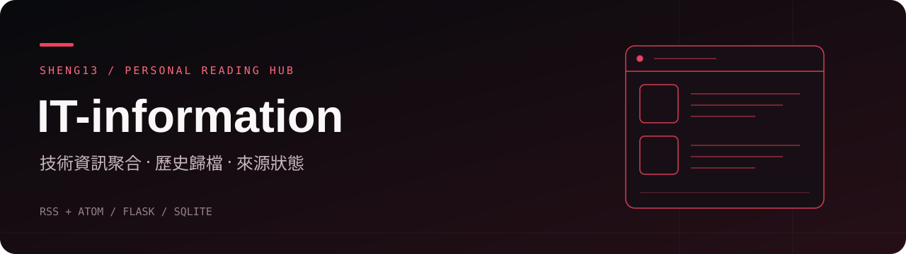

# IT-information

以 Flask 與 SQLite 製作的 IT 資訊聚合網站，整合 RSS／Atom、軟體版本更新與 GitHub Trending。文章保存在資料庫，網頁提供日期歸檔、搜尋、分類與來源篩選，適合自架個人的技術閱讀入口。

[功能](#features) · [本機啟動](#local) · [Docker](#docker) · [使用與介面](#usage) · [專案地圖](#map) · [限制與資料來源](#limits)

> 應用程式、依賴清單與 Docker 設定都在 `it-info-hub/`，不是儲存庫根目錄。下列功能與啟動方式依原始碼整理，本次未部署、抓取外部來源或執行測試。

<a id="features"></a>
## 功能

- 來源清單涵蓋資安、雲端、硬體、AI 與開源軟體版本；完整設定見 [app.py](it-info-hub/app.py) 的 `NEWS_SOURCES`、`RELEASE_SOURCES`。
- 依台灣時區的文章發布日期歸檔，搭配來源、分類、關鍵字、排序與未讀篩選。
- 收藏和已讀標記存在目前瀏覽器的 `localStorage`，不是伺服器帳號資料。
- 另存 GitHub Trending 每日快照；文章缺少摘要或圖片時，嘗試用 Scrapling 補取頁面資訊。
- 顯示來源健康狀態、錯誤與最後成功時間，可手動更新或只重抓失敗來源。
- 標題與摘要可要求翻成繁體中文；後端會將文字送至 MyMemory 外部翻譯服務。

直接執行 `app.py` 時，啟動後約 10 秒觸發首次背景抓取，之後每天 `Asia/Taipei` 09:00 排程更新。手動更新冷卻時間為 60 秒；同一程序的背景、排程與手動更新共用鎖。

<a id="local"></a>
## 本機啟動

若尚未準備 Python，Docker 設定採用 Python 3.12，可用作環境參考。以下使用 `uv` 建立隔離環境，不安裝到系統 Python：

```bash
cd it-info-hub
uv venv --python 3.12 .venv
uv pip install --python .venv/bin/python -r requirements.txt
.venv/bin/python app.py
```

開啟 `http://127.0.0.1:5001/`。程式實際監聽 `0.0.0.0`，同網路設備可能可連入；請先確認防火牆與存取範圍。按 `Ctrl+C` 停止。

| 環境變數 | 預設值與用途 |
|---|---|
| `PORT` | `5001`；直接啟動時的監聽埠 |
| `DB_PATH` | `app.py` 所在目錄的 `it_info.db`；自訂時請先準備可寫入的父目錄 |

首次啟動會初始化資料表，並為舊資料補上分類與來源狀態欄位。設定透過程序環境傳入，程式未提供 `.env` 自動載入邏輯。

<a id="docker"></a>
## Docker

已安裝 Docker 與 Compose 後，在儲存庫根目錄執行：

```bash
cd it-info-hub
docker compose up -d --build
docker compose logs --tail=50 -f
```

[Compose 設定](it-info-hub/docker-compose.yml) 對應主機 `5001` 埠，並以 `it_info_data` named volume 掛載 `/app/data`；`DB_PATH` 設為 `/app/data/it_info.db`。本機直接啟動與 Docker 使用的資料位置不同，不會自動共用。

既有容器升級前，請先參閱 [子目錄的遷移說明](it-info-hub/README.md)，在停止容器後備份資料並確認舊 `/app/it_info.db` 已遷移至持久化位置，再重建。不要使用 `docker compose down -v`，那會移除資料 volume。SQLite 保存資料不等於有備份，仍需另行規劃還原驗證。

<a id="usage"></a>
## 使用與介面

1. 啟動後等首次抓取完成；從來源目錄檢查成功、失敗與尚未抓取的來源。
2. 用年月日選單選擇文章，再用關鍵字、來源與分類縮小目前載入的清單。
3. 收藏文章或標成已讀；清除瀏覽器資料或換裝置後，這些標記不會跟著移轉。
4. 若只有部分來源失敗，使用「重抓失敗來源」；整批失敗仍保留舊文章，不推進最後成功更新時間。

| 介面 | 用途 |
|---|---|
| `GET /` | 閱讀介面 |
| `GET /api/articles` | 最新文章；可加 `?date=YYYY-MM-DD` |
| `GET /api/archive` | 依發布日期統計文章數 |
| `GET /api/trending` | 最新或指定日期的排行快照 |
| `GET /api/status`、`GET /api/sources` | 更新狀態與完整來源目錄 |
| `POST /api/refresh` | 更新來源；JSON `{"failed_only": true}` 僅重抓失敗項目 |
| `POST /api/translate` | 翻譯 `title` 與 `summary`，合計上限 4000 字元 |

<a id="map"></a>
## 專案地圖

| 路徑 | 內容 |
|---|---|
| [it-info-hub/app.py](it-info-hub/app.py) | 來源設定、SQLite、擷取、API 與排程 |
| [it-info-hub/templates/index.html](it-info-hub/templates/index.html) | 閱讀介面模板 |
| [it-info-hub/static/app.js](it-info-hub/static/app.js) · [style.css](it-info-hub/static/style.css) | 前端篩選、收藏、已讀、翻譯互動與樣式 |
| [requirements.txt](it-info-hub/requirements.txt) | 固定版本依賴；包含 Flask、feedparser、APScheduler 與 Scrapling |
| [Dockerfile](it-info-hub/Dockerfile) · [docker-compose.yml](it-info-hub/docker-compose.yml) | 容器建置與資料持久化 |
| [test_migration.py](it-info-hub/test_migration.py) · [test_refresh.py](it-info-hub/test_refresh.py) | 舊資料遷移與更新失敗處理測試 |
| [test_scraping_sources.py](it-info-hub/test_scraping_sources.py) · [test_layout.cjs](it-info-hub/test_layout.cjs) | 來源設定與前端邏輯檢查 |
| [it-info-hub/README.md](it-info-hub/README.md) | 既有部署、遷移與抓取細節 |

在已準備好上述 `.venv` 的 `it-info-hub/` 目錄，可執行既有 unittest：

```bash
.venv/bin/python -m unittest test_migration test_refresh -v
```

另有 pytest 格式的來源檢查；`pytest` 不在應用依賴清單中。前端邏輯檢查使用 `node test_layout.cjs`，需另備 Node.js。本次沒有安裝依賴或執行這些測試，不將既有測試檔視為已通過的結果。

<a id="limits"></a>
## 限制與資料來源

- 擷取結果受 RSS 網址、外部網站政策、網路與 HTML 結構影響；例如程式已註記 Xiaomi 來源可能回傳 HTML。來源存在設定中，不代表目前抓取成功。
- 最新文章 API 最多回傳 500 篇，指定日期最多 1000 篇，沒有分頁；前端搜尋只涵蓋已載入的文章，不是資料庫全文檢索。
- 收藏與已讀沒有帳號同步。Trending 是當天快照，當日重抓會取代同日排行，不是每次抓取的不可變歷史。
- 排程及初始化寫在 `__main__`，直接匯入 Flask app 不會啟動它們；更新鎖僅在單一程序內有效，不宜直接改成多 worker 部署。
- 程式沒有登入驗證，更新與翻譯端點也會對連入者開放；內建 Flask 啟動方式與現有 Compose 設定不應直接當成對外正式部署方案。
- 翻譯會把傳入文字送到外部服務，請勿提交私人或敏感內容；該服務可能限流或不可用。
- 文章、圖片與專案名稱屬各來源權利人，閱讀完整內容請回到原始網址；聚合不代表重新授權。根目錄未附授權檔，重用程式與素材前請確認權利。

頁首 SVG 是本次新增的標題裝飾，不是網站截圖。這份 README 依原始碼與設定整理，不保證所有來源即時可用。
